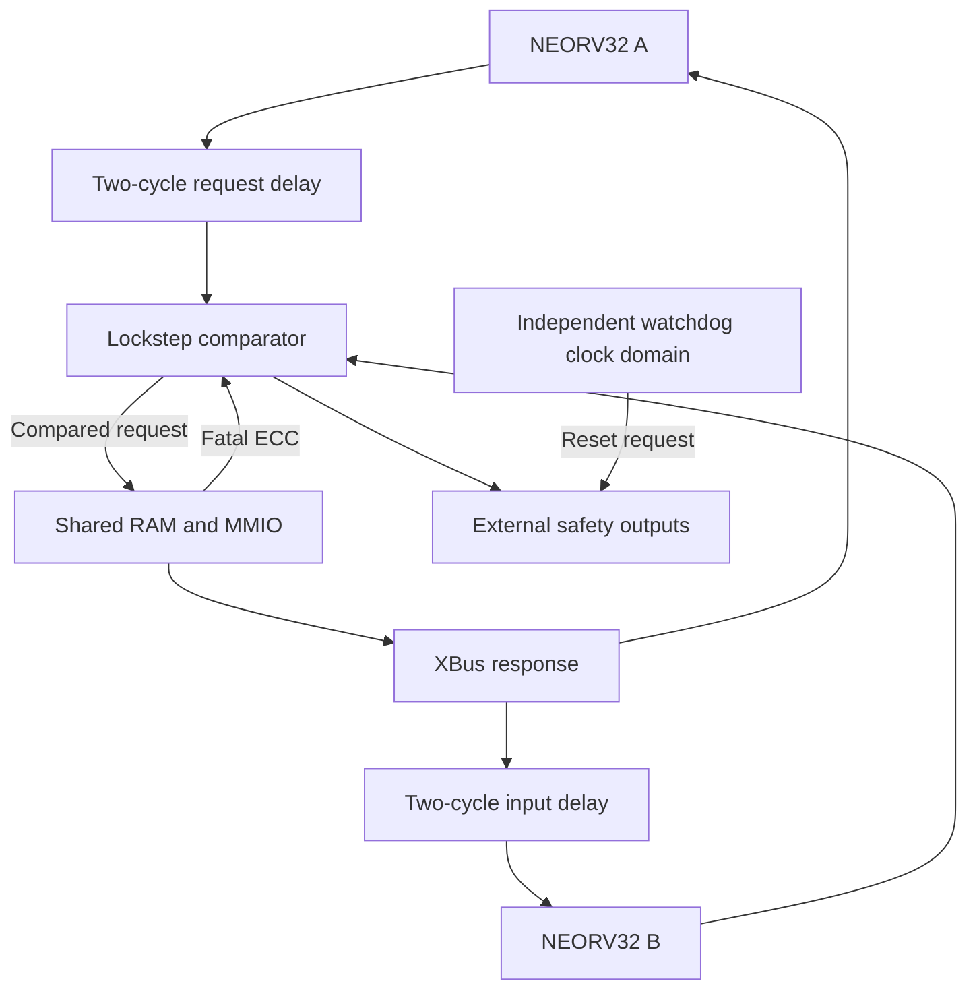

# lockstep-rv32-soc engineering roadmap

- **Baseline reviewed** [`102de394aa48aecc68018f505aa8057e724e35fc` on `main`][baseline]
- **Review date** November 12, 2026
- **Next release goal** A reproducible VHDL-2008 reference SoC that demonstrates fault detection and containment through an explicit hardware interface, with simulation evidence and a bench FPGA build.

## Status

Where each item stands on `main` (November 13, 2026). "Done" means the
acceptance below is met in simulation or formal proof; nothing has run on
hardware yet.

The repository evaluation, the baseline commands and the one-shot prompt
further down describe the baseline as reviewed, when the benches ran on VUnit
and OSVVM and lived in `sim/testbenches`. They are kept as written. The
current flow is in `docs/verification/toolchain.md`.

| ID | Status | Record |
| --- | --- | --- |
| R0.1–R0.3 | Done | `docs/verification/milestone_0_1.md` |
| R1.1–R1.4 | Done | `docs/verification/milestone_0_1.md`, HSI section 8 |
| R2.1 | Done: comparator, fabric and store commit proved, and the watchdog's kick and status crossings proved with two free clocks (multiclock, up to 3:1 in any phase, metastability not modelled), each with covers and a broken-RTL check | `docs/verification/formal.md` |
| R2.2 | Done for the core RTL: the RISC-V Architectural Certification Tests (ACT4) run in CI against NEORV32 v1.13.7, the revision both cores use, built with the pinned xPack GCC and checked against the Sail 0.16 reference model: all 347 pass. Both cores' retirements are compared in the RTL as well, every clock (`rtl/soc/retire_comparator.vhd`, HSI FLT-05), so a register-only divergence trips the SoC at the instruction. The ACT port's NEORV32 configuration is a superset of the SoC's | `docs/verification/isa_compliance.md`, `docs/verification/trace.md` |
| R2.3 | Done in RTL simulation at 20 sites, with four- and three-bit bursts, a persistent fault on the shared read data and the same disturbance in both cores at once. The campaign found the shared read data unprotected, now covered by parity (HSI 8.6), and faults inside the cores that stayed latent, now caught at the instruction by a retirement comparator in the RTL (HSI FLT-05), and reset-synchroniser upsets that restarted the cores unreported, now a fault (HSI RST-01): 146 of 157 effective faults detected, none latent. No netlist or timing faults | `docs/verification/fault_campaign.md` |
| R2.4 | Done as an evaluation: maximum diagnostic interval set, a latent compare failure and a reporting-path failure shown, a stuck sequencer reported. The redundant comparator it recommends is built: two comparators cross-checked every clock, with a latched disagreement (`rtl/safety/dual_comparator.vhd`); comparator B has its own reset, delay line and injection point, and the shared system clock is monitored against the watchdog clock (`rtl/safety/clock_monitor.vhd`, TSR_CLOCK_001) | `docs/verification/diagnostics.md` |
| R3.1 | Partial: board wrapper, constraints, build script with safety-structure checks, GHDL check in CI, and every bench run on Vivado's xsim as well as GHDL, with the two compared test by test. No build yet: the installed Vivado is the Enterprise edition with only an Alveo licence; adding Vivado ML Standard, or its free licence, unblocks it | `docs/verification/bench_hardware.md`, `fpga/arty_a7_100t/README.md` |
| R3.2 | Blocked on hardware; the bench equipment is listed | `docs/verification/bench_hardware.md` |
| R3.3 | Done in simulation: the board program (C, with shared startup and trap code, linker script and helpers in `sw/common`) checks the ECC RAM and sends a CAN frame, and a hello-world program shows the smallest build; `sw/build.py` builds both with the pinned xPack GCC 15.2.0-1, CI checks the images, both run on GHDL and xsim, and `build.py --program` puts either on the board. The board guide covers setup, the JA4 to JB7 jumper and the bench tests | `fpga/arty_a7_100t/README.md` |
| R4.1 | Done in simulation: protection map, writeback, patrol with a measured bound, first-fault telemetry on an independent read-only port | `docs/verification/memory_protection.md`, HSI 8.5 |
| R4.2 | Partial: support matrix with simulation evidence, and the board program's CAN frame acknowledged by a second node in simulation; bench validation needs the transceiver and analyser listed | `docs/verification/can_support.md`, `docs/verification/bench_hardware.md` |
| R4.3 | Done, but for area and timing per profile, which need a Vivado build | `docs/verification/integration.md` |
| M5.1 | Done as a reference item: a torque-enable supervisor for an EV traction inverter, with options considered, hazard analysis, safety goals, FTTI and assumptions of use; a real product replaces it | `docs/safety/item_definition.md` |
| M5.2–M5.4 | Started: FMEDA input table and checker, with no single-point failure mode left (the actuator line has a read-back and a second channel; CAN is covered by the protocol and the item's end-to-end protection; the UART is diagnostic only); dependent-failure checklist; evidence index checked in CI; statement and branch coverage at 100 %. Failure rates, review and assessment pending | `docs/safety/fmeda_inputs.csv`, `docs/safety/dependent_failure_analysis.md`, `docs/safety/evidence_index.md`, `docs/verification/coverage.md` |


### Next, in order

What the fault campaign and the evidence leave open, most valuable first. The
first two need the user or hardware; the rest can be done in simulation.

1. **A Vivado build (R3.1).** Add Vivado ML Standard, or its free licence, and
   run `fpga/arty_a7_100t/build.py`. It gives area and timing per profile
   (R4.3), checks that synthesis kept both cores, the delay lines, the parity
   check and the retirement comparator, and makes the bitstream for the board.
2. **Board bring-up and bench tests (R3.2, R4.2)** with the board guide.
3. **Self-test of the retirement comparator.** Its output stuck at "no
   difference" is latent until a proof test (FMEDA FM-26). The startup self-test
   could inject a difference into core B's record, as it does on the bus.
4. **Instruction memory ECC.** A fault stored in an instruction both cores fetch
   is a common-cause fault; the cores' 16 KB IMEMs have no ECC (HSI section 5).
5. **The output registers after the comparator.** Upsets in the UART and CAN
   output registers corrupt the pins unseen (campaign sites 11, 12). CAN is left
   to the protocol and the item's end-to-end protection, and the UART is
   diagnostic only; a read-back of CAN TX against a second copy of the bit
   would close it in the SoC.
6. **FMEDA failure rates** from a named source for the target, then the metrics
   (M5.2).
7. **A fail-operational study** if the item must keep working after a fault:
   two of these SoCs as a dual-duplex pair with independent clocks, resets and
   supplies, and arbitration of the outputs.
8. **A fault-injection build for the board,** so the bench can show a trip and
   measure the reaction time on the real pins.
9. **GHDL fork follow-ups.** Make GHDL's analysis time stamps monotonic, so a
   clock that steps back cannot make a correctly ordered library look obsolete
   (`run.py` works around it for the GCC backend today); upstream the
   external-name support; then run statement coverage of the whole regression
   with the GCC backend and gcov, as a second measure beside xsim's.

The repository boots two NEORV32 instances, runs firmware through the compared bus, and exercises ECC, watchdog, reset, CAN and UART behavior. The wire-level reference vectors, firmware tests and mutation harness give the next release a way to verify changes at each boundary. Prioritize the paths from fault detection to bus termination and physical output containment. The current evidence supports a research prototype. Automotive integration and any ASIL claim depend on a target implementation, a defined item and reviewed safety evidence.

## Repository evaluation

The review covered the 76 first-party tracked files at the baseline, the two Git submodule pins and the upstream RTL, boot and verification interfaces used by this SoC.



| Area | Baseline implementation and evidence |
| --- | --- |
| CPU and clocks | Two separately instantiated, identically configured single-hart NEORV32 tops at a nominal 50 MHz. The simulation reports `rv32ix_zicsr_zifencei`. The wrapper disables M, C, A, U, caches, internal data RAM and most upstream I/O. It exposes a system clock and a separate watchdog clock input. NEORV32 is pinned to `4d6eaf3fde1edfe7421083fd8412d30200466e85`. [SoC configuration][top-config] · [NEORV32 data sheet][neorv32] |
| Comparison and startup | Core B receives the changing input record two clocks after A. The comparator matches the delayed A address, data, byte selects, write enable and strobe against B. The comparator checks all five fields even in idle cycles. An observed mismatch or fatal ECC indication blocks the current request combinationally. A registered state drives downstream permission. Cold-start self-test checks 70 request bits and the fatal input through the real comparator and holds normal reset until it passes. A watchdog reset preserves a prior lockstep trip. [Top wiring][top-wiring] · [Comparator][compare] · [Startup self-test][bist] |
| Memory and response | Each core has a nominal 16 KiB internal IMEM configuration and local access to upstream resources such as SYSINFO. Those accesses bypass the external comparator. The shared data RAM spans `0x20000000`–`0x2003FFFF` and uses 72-bit words with 64 data bits and 8 SECDED check bits. Partial stores merge corrected data and regenerate check bits. SBE reads return corrected data and increment telemetry. A subsequent store can repair the codeword. Background patrol is future work. Peripherals return registered data that the top ORs together. [ECC RAM][ram] · [ECC codec][ecc] · [Bus response][top-ack] |
| Watchdog and reset | A windowed watchdog with 40,000 and 50,000 tick boundaries is in the watchdog clock domain. A request/acknowledge crossing carries software kicks and a bundled-data handshake returns status. The watchdog produces a 16-tick reset pulse. The top synchronizes reset release by domain and uses an immediate reset request to put the actuator-safe output and CAN TX in their reset states. [Watchdog][watchdog] · [Watchdog supervisor][supervisor] · [Reset wiring][top-wiring] |
| CAN and UART | CAN TX sends Classical CAN base-format data frames with arbitration, retry, CRC and stuffing. RX accepts base and extended data and remote frames, checks the wire format, ACKs good frames and buffers one frame. TX and RX implement error counters. Bus-off stays latched until reset and overload handling is receive-side. UART is a TX-only 8E1 diagnostic channel with one pending byte and a fixed divisor, nominally 115,200 baud at 50 MHz. [CAN controller][can-tx] · [CAN receiver][can-rx] · [UART][uart] |
| Firmware | The Python generator builds a 122-instruction, 256-word simulation image. It exercises byte stores to ECC RAM, CAN TX/RX and IRQs, UART status and watchdog resets. Firmware-driven tests use IMEM image mode 2. Mode 0 defaults to the upstream bootloader with UART0 disabled, and the mode-0 bench checks reset and safety pins. Mode 1 points at `0x00000000`. A board firmware build, linker script and executable boot contract are future work. [SoC configuration][top-config] · [Firmware generator][firmware] · [Firmware bench][tb-fw] · [Default-mode bench][tb-integration] |
| Verification and delivery | The repo has 35 VUnit benches, OSVVM coverage in selected benches, hierarchical fault injection, two generated fixtures, two Actions workflows and safety documentation. The active runner uses VUnit's bundled OSVVM via `vu.add_osvvm()`. The separate `sim/OsvvmLibraries` pin `249495946eb113284d243ffa9fa8362c296e9d96` is fetched by CI and sits outside this runner's source list. The runner performs GHDL analysis and synthesis as a lint gate. Board constraints, place-and-route evidence and a formal proof job are future work. [Runner][runner] · [CI][ci] · [PR workflow][compliance] |

### Reproduced baseline

| Check | Result |
| --- | --- |
| GitHub push CI for the reviewed SHA | Successful GHDL semantic and synthesis lint, VSG lint and regression. [GitHub Actions run][baseline-ci] |
| Independent local run | **194 passed, 0 failed, 0 skipped** across 35 benches using Debian GHDL 5.0.1 mcode, Python 3.12.14, VUnit 4.7.1 and VSG 3.35.0. Both lint gates passed. The same run emitted a VUnit deprecation notice and third-party/metavalue warnings. |
| Generated artifacts | `soc_firmware.py` and `can_frame_model.py` reproduced both checked-in VHDL fixtures byte for byte. The CAN package contains 20 nominal frames and 12 error or boundary vectors. |
| Mutation checks | All 386 substitutions still applied. The local sample killed four mutants covering mismatch detection, early watchdog kicks, UART write gating and ECC double-bit detection. The safety case records 386 kills against historical RTL/test commit `057c639`. The independent review reran four mutants. [Harness][mutation] · [Historical result][safety-case] |
| Synthesis smoke | GHDL synthesis of mode 2 with the test image produced a design with both CPU instances and inferred a 32,768 × 72 RAM. This verifies the front-end path. Device mapping, timing, physical redundancy and hardware tests remain open. |

Run the following from the repository root with GHDL mcode on PATH.

```bash
git submodule update --init --recursive
python3 -m venv .venv
. .venv/bin/activate
python -m pip install vunit_hdl==4.7.1 vsg==3.35.0
python sim/scripts/soc_firmware.py
python sim/scripts/can_frame_model.py
git diff --exit-code -- sim/firmware/neorv32_imem_image.vhd sim/generated/can_rx_frames_pkg.vhd
python sim/scripts/mutate.py --check
python sim/scripts/mutate.py -p 4 'mismatch never detected' 'early kick ignored' \
  'safety gate ignored on write' 'double flips not fatal'
(cd sim && python run.py -p 4 --xunit-xml vunit_out/baseline.xml)
```

### Findings that drive the release order

| Priority | Finding | Consequence |
| --- | --- | --- |
| P0 | **A fatal RAM load can complete as a successful zero-valued load.** A local GHDL probe forced two bits in the RAM output on a firmware load. The CPU-facing XBus response had `ACK=1`, `ERR=0` and zero data while the external fault pin was high. The top currently registers ACK from the accepted strobe and ties both XBus ERR inputs low. An unmapped request that reaches this fabric also gets the generic ACK and zero read data. [Response register][top-ack] · [Core A XBus port][top-xbus] · [RAM response][ram-response] | Define how an accepted access terminates, including when a late ECC fault arrives. Keep fatal isolation independent of CPU handling. |
| P0 | **The comparator can close the bus without reporting the original fault.** Forcing the normal state `0x5A` to `0x5B` closed the transaction gate while both external fault and actuator-safe outputs stayed low. After one system edge and removal of the force, actuator-safe asserted and the fault pin stayed low. The encoded state and fault latch have separate update conditions. [State and outputs][compare-state] | Decode invalid state as a fault, define pin timing and preserve the fault across a warm reset. |
| P0 | **A lockstep trip leaves an in-flight UART byte active.** A local SoC probe tripped lockstep during the first UART start bit. The pin still drove that bit 1 µs after `actuator_safe_o` asserted. UART gates MMIO writes, while its serializer and pin have their own logic. A reset also relies on system-clock edges to stop that serializer. CAN has a separate pin gate. [UART serializer][uart-output] · [CAN pin gate][can-output] · [Top safety outputs][top-outputs] | Specify which pins idle or abort under cold reset, watchdog reset and fatal trip, including a stopped system clock. |
| P0 | **The external fault indication and the CPU interrupt have different semantics.** The external `nmi_fault_o` is driven by hardware. The same comparator indication enters both CPUs through the maskable machine external interrupt, MEI. The checked-in smoke firmware enables MSI and MTI only. [Top interrupt wiring][top-wiring] · [Pinned NEORV32 interrupt logic][neo-irq] · [RISC-V privileged ISA][riscv-priv] | Keep the public pin compatible and document its meaning. Make the containment contract independent of interrupt masks and any trap handler. |
| P0 | **The watchdog has two different decisions at the upper window boundary.** A direct watchdog probe at count 50,000 with a kick saw the combinational late/reset indication assert while the counter process accepted the same kick. The supervisor samples the violation path. The watchdog clock can also be absent at cold start while the SoC releases, as an existing regression explicitly demonstrates. [Watchdog boundary][watchdog-count] · [Supervisor reset][supervisor-reset] · [SoC clock-stop tests][tb-wd] | Choose one inclusive or exclusive boundary and one sampled outcome, including CDC phase. Treat watchdog clock loss, reset retention and independent board supervision as separate requirements. |
| P0 | **The timing evidence begins at different points.** The SoC ECC test starts its 50 µs wait after `ecc_fatal`. An error in an idle codeword or private CPU state can take longer to become observable. Core A has two additional cycles before comparison. At 50 MHz, two cycles are 40 ns. At an illustrative 1 MHz watchdog clock, 50,000 ticks are about 50 ms before reset overhead. [ECC test][tb-ecc] · [Lockstep timing in HSI][hsi] · [Watchdog constants][types] | Give each fault class a budget with a named origin, observation point, isolation edge and external safe-state measurement. Allocate a separate liveness budget. |
| P0 | **The published safety metrics disagree.** The FMEDA summary lists 99.2% SPFM and 97.8% LFM, while the safety case uses 96.76% and 98.92%. Both print 90% and 60% as ASIL D thresholds. The public reference targets are ≥99% SPFM, ≥90% LFM and ≤10 FIT PMHF. Even the FMEDA's simplified arithmetic is inconsistent. Its stated LFM ratio evaluates to 99.86%, and its PMHF expression evaluates to 0.01525 FIT, or 1.525 × 10⁻¹¹/h, under its own inputs. These recalculations are arithmetic checks only. The row categories and assumptions still need a target-specific method. [FMEDA][fmeda] · [Safety case][safety-case] · [TI hardware-metrics table][ti-metrics] · [ISO 26262-5][iso5] |
| P1 | **The compare boundary misses internal and shared failure modes.** NEORV32 trace is disabled. `p_diag_monitor` reads signals into branches with no effects. CPU-private register or instruction errors become visible only when they influence the observed bus. Shared read data, clock, power, reset, image generation, decode, the comparator and final pin logic have different dependencies. The startup self-test leaves a diagnostic interval as long as the time between cold resets. The comparator has explicit encodings, while CAN, UART and BIST control use enumerated types. State distances in the implemented netlist need evidence. [Disabled trace][top-config] · [Diagnostic process][top-outputs] · [Self-test scope][bist] · [CAN controller][can-tx] · [UART][uart] |
| P1 | **The safety documentation overstates current verification.** The PR workflow checks for a checklist heading and runs GHDL. It has no structural coverage, netlist fault-injection or proof job. In particular, `tb_fsm_illegal_recovery` exercises CAN gate and traffic stress, while the older `tb_soc_bus_concurrency` stimulates the comparator directly and has no slave response channel. Existing VHDL assertions provide simulation evidence. The HSI also mixes planned Flash, comparator CSRs and startup timing with implemented behavior, and the traceability table mixes `TSR_LOCKSTEP_001` and `TSR_LOCKSTEP_042`. [Verification specification][verification] · [Workflow][compliance] · [Trace matrix][traceability] · [CAN stress bench][tb-fsm] · [Comparator traffic bench][tb-concurrency] |

## Research and design choices

| Question | Reference evidence and implication for this design |
| --- | --- |
| Where should lockstep compare? | Ibex SecureIbex delays inputs to a shadow core and compares aligned outputs. Ibex also uses integrity protection for memory and selected CPU structures. TI Hercules documents a compare error path into an error signaling module and distinct diagnostics for the compare and reporting paths. Keep the present two-cycle, pre-side-effect XBus compare. Add retirement comparison as a separately measured diagnostic and define independent containment and reporting paths. [Ibex design][ibex] · [TI Hercules safety manual, §7.11 and error-signaling diagnostics][hercules] |
| How much detection latency can be claimed? | Dörflinger et al. measure fault propagation under representative workloads and assess implementation costs separately on FPGA and ASIC. Adopt workloads that expose register, control, memory and stalled-bus faults. Publish latency distributions and the worst observed time with the fault model and workload. Provide a proof or a target-backed argument for any guaranteed upper bound. [A Framework for Fault Tolerance in RISC-V][fault-paper] |
| What verifies RISC-V behavior? | The ratified specifications define ISA and trap behavior. ACT4 generates DUT-specific self-checking ELFs using a configuration, model macros and linker script. A configured Sail or Spike tandem run checks instruction effects independently. NEORV32 exposes a trace record with order, register, PC, trap and memory fields. Verify the adapter's semantics before using it as RVFI. These activities complement fault containment tests. [RV32I specification][riscv-unpriv] · [Privileged ISA][riscv-priv] · [ACT4][act] · [Sail RISC-V][sail] · [Ibex tandem example][ibex-cosim] · [RVFI][rvfi] |
| What does formal evidence add? | GHDL can serve as the VHDL synthesis front end for Yosys. SymbiYosys defines bounded checks, proofs and reachability covers. A small comparator, response gate and reset harness is a practical first target. Record clock/reset assumptions and solver status, and exercise each assertion antecedent with cover tasks. Keep diagnostic coverage, code coverage, mutation kills and formal results as individually traceable evidence. [GHDL synthesis][ghdl-synth] · [SymbiYosys tasks][sby] · [OSVVM][osvvm] |
| What survives implementation? | AMD documents reset synchronizers, structural CDC reports, RAM inference modes and synthesis controls that affect preservation and placement. Count both implemented cores, verify delay stages and safety state encodings in the mapped design and confirm RAM write-first behavior. Measure actual clock and output behavior on one board. Add device configuration-memory protection to the dependent-failure analysis where applicable. [AMD reset/CDC guide][amd-reset] · [RAM inference][amd-ram] · [Synthesis attributes][amd-attrs] · [AMD SEM][amd-sem] |
| How should CAN scope be stated? | ISO 11898-1 defines the data link and coding layer. ISO 11898-2 covers the high-speed physical medium attachment, and ISO 16845-1 is a conformance test plan. Preserve the documented Classical CAN subset and validate it against an independent controller on a terminated bench link. Keep a per-feature support and conformance matrix. [ISO 11898-1][iso-can] · [ISO 11898-2][iso-can-phy] · [ISO 16845-1][iso-can-test] · [SocketCAN][socketcan] |
| What would support an automotive safety claim? | ISO 26262 separates hardware development, supporting processes and safety analyses. Build the case around a defined item, assumptions of use, a selected target, an auditable FMEDA and dependent-failure analysis, verified diagnostic intervals and tool-confidence evidence for the actual workflow. A commercial fault simulator can provide evidence for a defined use case. The project still needs to justify that use case and the target-level result. [ISO 26262-5][iso5] · [Part 8][iso8] · [Part 9][iso9] · [Part 11][iso11] · [Siemens functional safety flow][questa] |

## Delivery roadmap

| Milestone | Priority | Suggested effort | Gate |
| --- | --- | --- | --- |
| 0. Reproducible baseline and contracts | P0 | 2–4 engineer-days | CI emits reproducible test evidence and documentation distinguishes the current implementation from requirements and open evidence. |
| 1. Fault containment at the bus and pins | P0 | 1–2 engineer-weeks | Directed regressions exercise each reproduced fault end to end, and transaction completion and reset behavior match the written contract. |
| 2. Independent verification and diagnostic coverage | P1 | 2–4 engineer-weeks | Formal results, an instruction-trace pilot and a repeatable fault campaign cover named requirements with explicit assumptions. |
| 3. FPGA reference implementation and firmware | P1 | 2–4 engineer-weeks | One board image boots, meets timing, preserves redundancy and demonstrates fail-safe behavior on a bench. |
| 4. Peripheral interoperability and memory hardening | P2 | 2–4 engineer-weeks | One pinned hardware/software profile has a verified memory protection map and an independently tested Classical CAN subset. |
| 5. Target-specific safety evidence | P2 | Target and assessor dependent | Traceability, dependent-failure analysis and FMEDA can be rebuilt from the selected target and reviewed evidence. |

Estimates assume one engineer, the current submodule pins and the existing simulator flow. Milestones 2 and 3 can overlap after milestone 1 fixes the observable interfaces. Work on the evidence schema can start in milestone 0.

### Milestone 0 — Baseline, terminology and reproducibility

| ID | Work | Acceptance |
| --- | --- | --- |
| R0.1 | Make the active GHDL mcode and VUnit path explicit. Use one documented simulator selection path, pin the Python dependencies, and identify the OSVVM source actually compiled. Investigate the Windows compatibility path before narrowing its GHDL monkey patch to the configuration that needs it. Treat licensed simulators as explicit jobs with their own tool versions and evidence. | A fresh clone runs compile, semantic/synthesis lint, VSG and all baseline regressions. CI archives a compact xUnit result and tool/submodule manifest on success, plus scoped logs on failure. Demonstrate separate working outputs for concurrent runs before supporting them. |
| R0.2 | Reconcile README, HSI, TSRs, safety case and verification spec with the RTL. Record the actual boot modes, reset domains and 2-cycle skew, maskable IRQ mapping, implemented and reserved addresses, UART/CAN scope and the limits of evidence. Record the current FMEDA values as illustrative and retain their provenance. Document 100% goals only where the project defines the scope and evidence. | Resolve orphan and duplicate requirement IDs, including the lockstep aliases and references for ECC, watchdog, UART and common types. Each claimed requirement links to RTL and a named test, or is recorded as planned. The PR workflow name and description reflect its checks. [HSI][hsi] · [TSRs][tsr] · [Traceability][traceability] |
| R0.3 | Turn fixture regeneration and mutation applicability into cheap checks. Keep the standalone shell lint script clearly labeled as a heuristic or replace its callers with the real lint entry point. Remove duplicated CI stages where they add no evidence. Track warnings from first-party and upstream code by provenance and use deterministic seeds for randomized tests. | Both fixtures regenerate byte for byte. A stale mutation pattern fails its check. Explicit CI lint invocations fail if their tools are absent. Artifacts report the number of discovered, passed, failed and skipped tests. |

### Milestone 1 — Close the fault-containment paths

| ID | Work | Acceptance |
| --- | --- | --- |
| R1.1 | Give the compared interconnect an explicit request, selected target and terminal response. Carry read data, ACK and ERR in the same record and replay the response to B with the two-cycle offset. Replace the OR of slave outputs with a selected response. Define decode, byte enables, register directions, holes, aliasing and timeout behavior. Preserve documented no-op access semantics at mapped registers, including the byte store to CAN TX_REQUEST in the smoke firmware. Document unmapped access errors as an intentional HSI change from zero/ACK. Preserve the pinned NEORV32 XBus alignment contract and specify how CYC, CTI and TAG are handled. | Accepted mapped requests complete exactly once. ACK and ERR are mutually exclusive. An unmapped request receives one bounded error with zero side effects. A mismatch blocks a request at the commit edge. New tests reach the CPU through real loads/stores, including boundaries, byte lanes, a rejected write, warm reset with a response pending, delayed B response and back-to-back accepted requests. |
| R1.2 | Carry a selected RAM completion through ECC checking and store commit. Return corrected data with ACK for a correctable load. Complete the already accepted DBE transaction with ERR and zero data while independently latching the fatal fault and rejecting future requests. Commit a partial write exactly once after the corrected merge and only while its commit conditions hold. Separate the cold-cleared telemetry from the warm-cleared transaction state. | Regress a DBE on a firmware load and partial store, verify the XBus pins and a load/store access fault in NEORV32, and verify no destination writeback or memory update. Inspect both harts through their aligned response paths. Run collision and reset tests for both halves of a codeword and a late DBE concurrent with another candidate request. |
| R1.3 | Establish one fail-safe truth table for cold startup, BIST fail, normal run, fatal compare/ECC fault, illegal encoded state and watchdog restart. Decode an invalid comparator state as a reportable fault. Register the lockstep trip that controls the physical gate so normal comparator settling cannot glitch the pins. Gate UART TX to mark/idle on reset or registered trip, abort the active byte and clear pending data. Check CAN recessive and actuator-safe behavior at the top level. Preserve the external `nmi_fault_o` name for compatibility and document MEI as optional software notification. | Mask MEI and global MIE in firmware and demonstrate the same hardware containment timing. Force all one-bit corruptions of the normal comparator encoding, and test retention across a warm reset and requalification after cold reset. Inject trips while UART and CAN transmit and check pin levels and that an abandoned byte/frame cannot resume. With the system clock stopped, exercise asynchronous reset containment separately from clocked lockstep detection. |
| R1.4 | Resolve the watchdog boundary in both the counter and supervisor. Use one sampled decision after CDC. The proposed window accepts a kick sampled at either MIN or MAX and times out at MAX in the absence of a kick. Document duplicate-kick coalescing, reset-cause validity, minimum reset assertion, software restart and behavior when either clock is absent or stops. Open a target requirement for watchdog clock-loss containment with an independent supervisory path. | Run exact MIN−1, MIN, MAX−1, MAX and expired/no-kick cases at the watchdog and supervisor boundaries. Vary clock ratios and phase. Verify sticky lockstep fault retention, watchdog reason validity and asynchronous pin-safe behavior while the primary clock is stopped. Record the clock-loss assumption until an external supervisor is tested. |

Timing tests should record a fault injection timestamp, first observable divergence or ECC error, the accepted or blocked bus edge, fault pin and safe pin. Use the comparator boundary for the local two-cycle requirement. Use 50 µs as a provisional SoC fault-response target for the defined observable fault classes. The item-level fault-tolerant time interval (FTTI) needs a hazard-derived allocation for detection, the supervisor, output drivers and the external safe state. Set a separate diagnostic test interval for latent faults. Capture measured maxima and the remaining budget.

### Milestone 2 — Independent verification and diagnostic coverage

| ID | Work | Acceptance |
| --- | --- | --- |
| R2.1 | Start formal checks on the comparator, delayed input record, request/response and safety gate. Cover valid traffic, rejected writes, matched and mismatched reads, late fatal errors, reset with a pending write, and legal and invalid state encodings. Add assumptions for stable sampling and clock progress. Model CDC handshakes as a separate proof problem with named clock assumptions. | Store property IDs, tool/solver versions, mode, depth, assumptions and results. Demonstrate reachability of each safety assertion's antecedent. Report bounded results with the depth and prove invariants where tractable. Check a deliberately broken property path against the harness. |
| R2.2 | Done for the core RTL: the RISC-V Architectural Certification Tests (ACT4) run in CI against the NEORV32 revision both cores use, built with the pinned xPack GCC and checked against the Sail 0.16 reference model; the trace comparison of both cores catches a register-only divergence. The ACT port's NEORV32 configuration is a superset of the SoC's | `docs/verification/isa_compliance.md`, `docs/verification/trace.md` |
| R2.3 | Build a repeatable fault manifest with injection location, type, time, duration, workload, expected safety response, observed outcomes and waveform reference. Exercise private IMEM/GPR/PC and control state, XBus signals, the delay line, BIST and comparator state, shared response/decoder logic, ECC word/address/control, watchdog CDC, and final pin logic. Add cases for bursts of simultaneous disturbance and persistent common inputs, with representative control-flow and memory workloads. | Results distinguish injected, activated, masked, detected in time, detected late, hazardous/undetected and invalid trials. Report coverage and latency per fault class with denominators and seeds. Archive mutation results separately. Run quick representative shards routinely and the full applicable campaign for a release. |
| R2.4 | Evaluate a redundant comparator/permit path or independently checked status path for faults arising after startup. Compare its resource and latency cost against a periodic proof test performed in a quiescent safe state. Add protection or explicit monitoring for self-test state and progress, including a stuck-busy sequencer. | Establish a maximum diagnostic interval under the intended duty cycle. Demonstrate both a latent compare failure and a failure in the error-reporting path. Faulted or interrupted diagnostics retain safe outputs and cannot grant bus permission. |

Keep retirement comparison diagnostic until there is an explicit retirement-to-store ordering contract. The existing bus gate remains the authority for committing external side effects. A shared wrong response can agree at both compare points, so prioritize independent integrity checks and address/decode fault coverage.

### Milestone 3 — FPGA reference build and usable firmware

| ID | Work | Acceptance |
| --- | --- | --- |
| R3.1 | Partial: board wrapper, constraints, build script with safety-structure checks, GHDL check in CI, and every bench run on Vivado's xsim as well as GHDL, with the two compared test by test. No build yet: the installed Vivado is the Enterprise edition with only an Alveo licence; adding Vivado ML Standard, or its free licence, unblocks it | `docs/verification/bench_hardware.md`, `fpga/arty_a7_100t/README.md` |
| R3.2 | Blocked on hardware; the bench equipment is listed | `docs/verification/bench_hardware.md` |
| R3.3 | Done in simulation: the board program (C, with shared startup and trap code, linker script and helpers in `sw/common`) checks the ECC RAM and sends a CAN frame, and a hello-world program shows the smallest build; `sw/build.py` builds both with the pinned xPack GCC 15.2.0-1, CI checks the images are builds of the sources, and both run on GHDL and xsim | `fpga/arty_a7_100t/README.md` |

### Milestone 4 — Extend the verified operating envelope

| ID | Work | Acceptance |
| --- | --- | --- |
| R4.1 | Add a memory protection map for shared RAM, private IMEM/boot ROM, CPU register files, buses and external program storage if introduced. Constrain the ECC codec to supported word widths. Start with deterministic SBE repair using writeback or idle patrol. Choose a worst-case patrol interval and an arbitration policy that preserves CPU request deadlines. Add first-fault telemetry for cause, address, syndrome and time, with a read-only observation path independent of the closed application bus. | Exercise a persistent stored SBE, collision with foreground access, DBE in an idle region, initialization, and warm/cold retention. Measured worst-case patrol time fits the chosen interval. Telemetry remains readable while the primary bus is isolated, without reopening writes. Protect or document address/control and multi-bit upset assumptions. |
| R4.2 | Partial: support matrix with simulation evidence, and the board program's CAN frame acknowledged by a second node in simulation; bench validation needs the transceiver and analyser listed | `docs/verification/can_support.md`, `docs/verification/bench_hardware.md` |
| R4.3 | Reduce integration duplication with a shared NEORV32 instance wrapper and an authoritative register description that generates VHDL constants and firmware headers. Preserve independent test expectations for the interface. Add target-specific RAM/clock options at the board boundary. | Check generated files for drift and run equivalence-focused regressions before and after refactoring. Existing published register addresses and wire encodings retain their documented values. Record area and timing cost of each profile. |

A useful benchmark suite measures boot time, accepted load/store latency, interrupt-service latency, CAN throughput/overruns, ECC correction and fault response. Report min, median, maximum and workload, with clock rates and target settings. Revisit RV32M, alternate cores, TMR/fail-operational recovery, RTOS, CAN FD and ASIC only when a measured use case or a safety requirement justifies the cost and the additional verification surface.

### Milestone 5 — Build the safety evidence around a target

1. Define the item and assumptions of use with the integrator. Allocate safety goals, FTTI, diagnostic intervals, the external safe state, reset authorization, and behavior under power or clock failure. Decide how the component and the board-level supervisor share each obligation.
2. Build a versioned FMEDA input table with part/build identifier, mission profile, failure-rate source and unit, failure mode, safety goal, detection path, diagnostic interval, classification and evidence. Classify safe, single-point, residual and relevant multiple-point failure modes before calculating SPFM, LFM or PMHF. Trace each coverage estimate to a justified analysis or applicable campaign. Reconcile aggregate values with the source rows.
3. Perform dependent-failure analysis for shared FPGA resources, oscillator/power/reset dependencies, upstream common input corruption, synthesis merging and the comparator, permit and supervisor path. Identify assumptions about configuration memory, memory initialization and target environment. Include target-level timing, physical fault evidence and an independent review of tool confidence for each relied-on tool/version/use case.
4. Publish a versioned evidence index from requirement to implementation, test/property and measured result. Record evidence that is pending, waived with rationale or outside the scoped profile. Ship a research release with clear claims. A safety case and any external assessment then build on the exact hardware, firmware and operating profile.

### Release decision points

| Decision | Proposed starting point | Revisit when |
| --- | --- | --- |
| Execution model | One logical hart using delayed dual-core comparison. Fatal errors enter a latched safe state. | A concrete use case requires fail-operational behavior and can supply a voter/recovery and independence argument. |
| Fault reporting | Preserve the hardware fault pin name, document MEI, expose retained read-only diagnostics via a separately gated observation path. | A selected CPU and firmware contract explicitly require true NMI or RNMI. |
| Board profile | A single Vivado/Artix-7 target with an independent watchdog clock and an IMEM application image. | Measured resource or timing results point to a smaller RAM profile or a different device. |
| Peripheral scope | Classical CAN subset plus diagnostic UART at the documented rates. | Bench results or an integrator requirement justify queues, different rates or a new protocol. |
| Product assurance | Report RTL, formal, post-route and bench evidence tied to the configuration that produced it. | A defined item, evidence-backed FMEDA and independent review support a stronger claim. |

## References

Repository links below use the reviewed snapshot so line references remain stable.

[baseline]: https://github.com/Coastrnaut/lockstep-rv32-soc/commit/102de394aa48aecc68018f505aa8057e724e35fc
[baseline-ci]: https://github.com/Coastrnaut/lockstep-rv32-soc/actions/runs/42423667940
[top-config]: https://github.com/Coastrnaut/lockstep-rv32-soc/blob/102de394aa48aecc68018f505aa8057e724e35fc/rtl/top_automotive_soc.vhd#L286-L393
[top-wiring]: https://github.com/Coastrnaut/lockstep-rv32-soc/blob/102de394aa48aecc68018f505aa8057e724e35fc/rtl/top_automotive_soc.vhd#L196-L281
[top-ack]: https://github.com/Coastrnaut/lockstep-rv32-soc/blob/102de394aa48aecc68018f505aa8057e724e35fc/rtl/top_automotive_soc.vhd#L271-L281
[top-xbus]: https://github.com/Coastrnaut/lockstep-rv32-soc/blob/102de394aa48aecc68018f505aa8057e724e35fc/rtl/top_automotive_soc.vhd#L474-L485
[top-outputs]: https://github.com/Coastrnaut/lockstep-rv32-soc/blob/102de394aa48aecc68018f505aa8057e724e35fc/rtl/top_automotive_soc.vhd#L953-L998
[compare]: https://github.com/Coastrnaut/lockstep-rv32-soc/blob/102de394aa48aecc68018f505aa8057e724e35fc/rtl/safety_blocks/lockstep_comparator.vhd
[compare-state]: https://github.com/Coastrnaut/lockstep-rv32-soc/blob/102de394aa48aecc68018f505aa8057e724e35fc/rtl/safety_blocks/lockstep_comparator.vhd#L101-L182
[bist]: https://github.com/Coastrnaut/lockstep-rv32-soc/blob/102de394aa48aecc68018f505aa8057e724e35fc/rtl/safety_blocks/comparator_self_test.vhd
[types]: https://github.com/Coastrnaut/lockstep-rv32-soc/blob/102de394aa48aecc68018f505aa8057e724e35fc/config/package_soc_types.vhd
[ram]: https://github.com/Coastrnaut/lockstep-rv32-soc/blob/102de394aa48aecc68018f505aa8057e724e35fc/rtl/safety_blocks/ecc_data_ram.vhd
[ram-response]: https://github.com/Coastrnaut/lockstep-rv32-soc/blob/102de394aa48aecc68018f505aa8057e724e35fc/rtl/safety_blocks/ecc_data_ram.vhd#L278-L286
[ecc]: https://github.com/Coastrnaut/lockstep-rv32-soc/blob/102de394aa48aecc68018f505aa8057e724e35fc/rtl/safety_blocks/hamming_ecc_wrapper.vhd
[watchdog]: https://github.com/Coastrnaut/lockstep-rv32-soc/blob/102de394aa48aecc68018f505aa8057e724e35fc/rtl/safety_blocks/hardware_watchdog.vhd
[watchdog-count]: https://github.com/Coastrnaut/lockstep-rv32-soc/blob/102de394aa48aecc68018f505aa8057e724e35fc/rtl/safety_blocks/hardware_watchdog.vhd#L56-L116
[supervisor]: https://github.com/Coastrnaut/lockstep-rv32-soc/blob/102de394aa48aecc68018f505aa8057e724e35fc/rtl/safety_blocks/watchdog_supervisor.vhd
[supervisor-reset]: https://github.com/Coastrnaut/lockstep-rv32-soc/blob/102de394aa48aecc68018f505aa8057e724e35fc/rtl/safety_blocks/watchdog_supervisor.vhd#L156-L187
[can-tx]: https://github.com/Coastrnaut/lockstep-rv32-soc/blob/102de394aa48aecc68018f505aa8057e724e35fc/rtl/peripherals/automotive_can_controller.vhd
[can-rx]: https://github.com/Coastrnaut/lockstep-rv32-soc/blob/102de394aa48aecc68018f505aa8057e724e35fc/rtl/peripherals/can_receiver.vhd
[can-output]: https://github.com/Coastrnaut/lockstep-rv32-soc/blob/102de394aa48aecc68018f505aa8057e724e35fc/rtl/peripherals/automotive_can_controller.vhd#L757-L773
[uart]: https://github.com/Coastrnaut/lockstep-rv32-soc/blob/102de394aa48aecc68018f505aa8057e724e35fc/rtl/peripherals/safe_uart.vhd
[uart-output]: https://github.com/Coastrnaut/lockstep-rv32-soc/blob/102de394aa48aecc68018f505aa8057e724e35fc/rtl/peripherals/safe_uart.vhd#L148-L243
[firmware]: https://github.com/Coastrnaut/lockstep-rv32-soc/blob/102de394aa48aecc68018f505aa8057e724e35fc/sim/scripts/soc_firmware.py
[runner]: https://github.com/Coastrnaut/lockstep-rv32-soc/blob/102de394aa48aecc68018f505aa8057e724e35fc/sim/run.py
[mutation]: https://github.com/Coastrnaut/lockstep-rv32-soc/blob/102de394aa48aecc68018f505aa8057e724e35fc/sim/scripts/mutate.py
[ci]: https://github.com/Coastrnaut/lockstep-rv32-soc/blob/102de394aa48aecc68018f505aa8057e724e35fc/.github/workflows/ci.yml
[compliance]: https://github.com/Coastrnaut/lockstep-rv32-soc/blob/102de394aa48aecc68018f505aa8057e724e35fc/.github/workflows/compliance.yml
[hsi]: https://github.com/Coastrnaut/lockstep-rv32-soc/blob/102de394aa48aecc68018f505aa8057e724e35fc/docs/safety/hsi_specification.md
[tsr]: https://github.com/Coastrnaut/lockstep-rv32-soc/blob/102de394aa48aecc68018f505aa8057e724e35fc/docs/requirements/tsr_safety_core.md
[safety-case]: https://github.com/Coastrnaut/lockstep-rv32-soc/blob/102de394aa48aecc68018f505aa8057e724e35fc/docs/safety/safety_case.md
[fmeda]: https://github.com/Coastrnaut/lockstep-rv32-soc/blob/102de394aa48aecc68018f505aa8057e724e35fc/docs/safety/fmeda_analysis.md
[traceability]: https://github.com/Coastrnaut/lockstep-rv32-soc/blob/102de394aa48aecc68018f505aa8057e724e35fc/docs/safety/traceability_matrix.md
[verification]: https://github.com/Coastrnaut/lockstep-rv32-soc/blob/102de394aa48aecc68018f505aa8057e724e35fc/VERIFICATION_SPECIFICATION.md
[tb-fw]: https://github.com/Coastrnaut/lockstep-rv32-soc/blob/102de394aa48aecc68018f505aa8057e724e35fc/sim/testbenches/tb_soc_firmware.vhd
[tb-integration]: https://github.com/Coastrnaut/lockstep-rv32-soc/blob/102de394aa48aecc68018f505aa8057e724e35fc/sim/testbenches/tb_soc_integration.vhd
[tb-ecc]: https://github.com/Coastrnaut/lockstep-rv32-soc/blob/102de394aa48aecc68018f505aa8057e724e35fc/sim/testbenches/tb_soc_ecc.vhd#L166-L203
[tb-wd]: https://github.com/Coastrnaut/lockstep-rv32-soc/blob/102de394aa48aecc68018f505aa8057e724e35fc/sim/testbenches/tb_soc_watchdog.vhd#L207-L257
[tb-fsm]: https://github.com/Coastrnaut/lockstep-rv32-soc/blob/102de394aa48aecc68018f505aa8057e724e35fc/sim/testbenches/tb_fsm_illegal_recovery.vhd#L80-L169
[tb-concurrency]: https://github.com/Coastrnaut/lockstep-rv32-soc/blob/102de394aa48aecc68018f505aa8057e724e35fc/sim/testbenches/tb_soc_bus_concurrency.vhd#L45-L138
[neo-irq]: https://github.com/stnolting/neorv32/blob/4d6eaf3fde1edfe7421083fd8412d30200466e85/rtl/core/neorv32_cpu_control.vhd#L825-L883
[neorv32]: https://stnolting.github.io/neorv32/
[ibex]: https://ibex-core.readthedocs.io/en/stable/03_reference/security.html
[hercules]: https://www.ti.com/lit/fs/spnu550b/spnu550b.pdf
[fault-paper]: https://leopard.tu-braunschweig.de/servlets/MCRFileNodeServlet/dbbs_derivate_00050474/riscv-framework-zweitpublikation.pdf
[riscv-unpriv]: https://docs.riscv.org/reference/isa/v20240411/unpriv/rv32.html
[riscv-priv]: https://docs.riscv.org/reference/isa/v20240411/priv/machine.html
[act]: https://github.com/riscv/riscv-arch-test
[sail]: https://github.com/riscv/sail-riscv
[ibex-cosim]: https://ibex-core.readthedocs.io/en/stable/03_reference/cosim.html
[rvfi]: https://github.com/YosysHQ/riscv-formal/blob/main/docs/source/rvfi.rst
[ghdl-synth]: https://ghdl.github.io/ghdl/using/Synthesis.html
[sby]: https://symbiyosys.readthedocs.io/en/stable/reference.html
[osvvm]: https://github.com/OSVVM/OSVVM
[amd-reset]: https://docs.amd.com/r/en-US/ug906-vivado-design-analysis/Asynchronous-Reset-Synchronizer
[amd-ram]: https://docs.amd.com/r/en-US/ug901-vivado-synthesis/Memory-Inference-Capabilities
[amd-attrs]: https://docs.amd.com/r/en-US/ug901-vivado-synthesis/Synthesis-Attribute-Propagation-Rules
[amd-sem]: https://docs.amd.com/r/en-US/pg036_sem/Introduction
[arty]: https://files.digilent.com/resources/programmable-logic/arty-a7/Arty-A7-100T-RevE-SoV.pdf
[iso-can]: https://www.iso.org/standard/86384.html
[iso-can-phy]: https://www.iso.org/standard/90697.html
[iso-can-test]: https://www.iso.org/standard/59166.html
[socketcan]: https://docs.kernel.org/networking/can.html
[iso5]: https://www.iso.org/standard/68387.html
[iso8]: https://www.iso.org/standard/68390.html
[iso9]: https://www.iso.org/standard/68391.html
[iso11]: https://www.iso.org/standard/69604.html
[ti-metrics]: https://www.ti.com/lit/wp/spradf6a/spradf6a.pdf
[questa]: https://www.siemens.com/en-us/products/ic/questa-one/functional-safety/iso-26262/

## Claude Code one-shot prompt

````text
You are the VHDL-2008 implementation engineer for Coastrnaut/lockstep-rv32-soc.
Read docs/ROADMAP.md, the HSI, TSRs, coding standard, verification spec, CI,
sim/run.py, mutation harness and all RTL/testbenches touched by the work. Read
applicable repository instructions. Review the current branch and working-tree
status. The roadmap is anchored at 102de394aa48aecc68018f505aa8057e724e35fc.
Use the current checkout as the base, verify each finding and preserve user work.
Implement milestones 0 and 1 as a reviewable patch series. If a gated item is
blocked, record the exact blocker and finish the independent in-scope items.

1. Establish the baseline before editing. Initialize pinned submodules and run
   the commands below with GHDL mcode, VUnit 4.7.1 and VSG 3.35.0, or a newer
   toolchain already pinned by the repo. Record tool versions and both pins.
   The original baseline has 194 tests across 35 benches. Account for any
   baseline changes. Use a new local work branch or the existing task branch.

       git submodule update --init --recursive
       python sim/scripts/mutate.py --check
       (cd sim && python run.py --lint)
       (cd sim && python run.py --vsg)
       (cd sim && python run.py -p 4 --xunit-xml vunit_out/baseline.xml)

   VUnit test patterns are positional. For example, from the root run
   (cd sim && python run.py "sim_lib.tb_soc_ecc.*" "sim_lib.tb_soc_lockstep.*").
   Use Python for portable checks. On Windows, run the same Python entry
   points from the indicated directory or a Git Bash/WSL shell.

2. Write a short, reviewable HSI decision table first. Specify the request
   acceptance edge, selected slave, response and write-commit edges, byte lane
   behavior, address holes and ACK/ERR exclusivity. Preserve address constants,
   CAN/UART wire formats, the two-cycle core offset and mapped MMIO behavior,
   including the no-op for a byte store to CAN TX_REQUEST. Document the
   intentional change to bounded ERR for unmapped external addresses. Keep
   explicit cold and warm reset domains, a sticky
   fatal fault until cold reset and the legacy nmi_fault_o output port. Define
   MEI as maskable diagnostic notification. Keep actuator safety independent
   of software masks, trap handling and MMIO availability.

3. Add directed failing regressions at the closest unit and one integration
   boundary before each RTL change. Use VUnit and existing forcing or checked
   firmware patterns. Reproduce the following on the baseline:
   - An accepted ECC double-bit load returns ACK=1, ERR=0 and zero on XBus.
     Force r_word(1 downto 0) during the known RAM load to 0x20000008 in the
     mode-2 test firmware. For the desired behavior require ERR without ACK,
     a load access fault, and zero corrupt-data writeback. Add the partial
     store case and check memory remains intact. Observe CPU A and the B
     response two clocks later. Use pinned NEORV32 trap or trace semantics.
   - Flip comparator state 0x5A to 0x5B in a healthy cycle. The original
     gate closes while the external fault indication stays low. Regress each
     one-bit corruption of the healthy encoding, including fault reporting,
     latch/actuator response and warm/cold reset behavior.
   - Trip lockstep during UART start or data. Verify UART reaches mark at
     the specified boundary and cannot resume its abandoned byte. At the
     top level also cover CAN recessive, queued work and actuator-safe.
     Cover asynchronous reset while the system clock is stopped separately.
   - Exercise a kick at MAX and the nearby MIN/MAX/no-kick boundaries at
     the timer and supervisor. Use the inclusive window defined in R1.4.
     Derive clock/phase cases from the CDC handshake. Cover watchdog
     reset cause and retention, and document absent watchdog-clock behavior.
   - Run a firmware scenario with both MIE and MEIE masked. Observe the
     external fault and isolation without depending on a CPU interrupt.
   - Add real fabric traffic for legal RAM/MMIO boundaries, unmapped aliases,
     disabled lanes, overlapping completion and reset with a pending store.
     Check an aborted/rejected request cannot write a slave or duplicate ACK.

4. Implement the smallest first-party changes that meet the tests. Extend
   t_core_inputs and temporal_diversity together for any new response field.
   Keep compare-before-side-effect as an invariant. Capture accepted request
   context before selecting a response. Let the already accepted fatal RAM
   operation complete with its explicit error while denying later requests.
   Decode an illegal comparator encoding into a sticky fault. Keep a
   registered trip controlling external gating to avoid transient comparator
   settling reaching the pins. For the UART, force mark under the specified
   reset/trip conditions and abort serializer and pending byte state. Retain
   distinct runtime and self-test conditions so the startup sequence still
   checks the genuine comparator. Preserve the NEORV32 and OSVVM submodule
   pins for this patch series.

5. Close the evidence loop. Reconcile the README, HSI, safety case, FMEDA
   status, traceability and verification spec with the implemented contract.
   Preserve historical numbers with provenance. Describe achieved simulation
   evidence, planned formal/FPGA work and the target assumptions required for
   ASIL metrics. Fix CI to publish a concise pass/fail report and tool
   manifest. Regenerate the firmware and CAN fixtures and review any diff.
   For deliberate RTL changes, update affected mutation patterns to retain
   their original failure meaning and add mutants for newly introduced
   safety invariants where the tests would otherwise miss a regression.

6. Finish in the same run. Run semantic lint, VSG, the full VUnit suite,
   mutation --check, a targeted sample for the changed paths and git diff
   --check. Use GHDL synthesis as a smoke test. Report tool availability,
   exact commands, counts, failed/skipped checks, named evidence and remaining
   hardware or assessor work. Keep local changes in small topical commits
   if Git identity is configured. Supply a review summary and checklist in
   the final response. Keep publishing and merging under maintainer control.

The work is complete when the original regression still passes where the
contract keeps that behavior, each reproduced gap has a regression that fails
before and passes after its fix, the HSI names the request/response and
safe-output boundaries, and the commit series is reviewable from its evidence.
````
